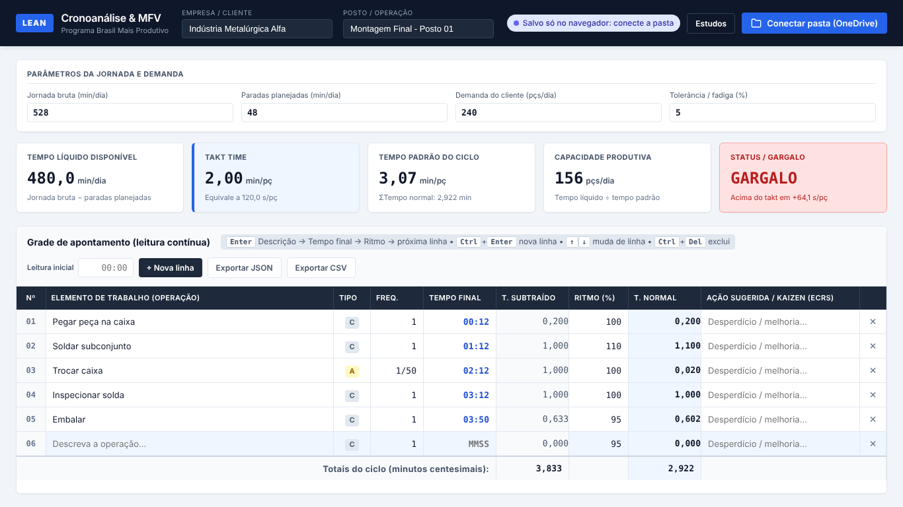

# Lean Chrono & MFV — Cronoanálise e apoio ao Mapa de Fluxo de Valor

Aplicação web **local-first** e **100% sem servidor** para cronoanálise de vídeos de operação, voltada a consultorias de produtividade industrial (Programa **Brasil Mais Produtivo**).

- **Digitação sem mouse:** o consultor assiste ao vídeo e digita só o instante de término de cada elemento (leitura contínua).
- **Cálculo Lean em tempo real:** tempo subtraído, tempo normal, tempo padrão, takt time, capacidade e semáforo de gargalo.
- **Funciona sem internet:** os dados ficam no navegador e na pasta do OneDrive do consultor, em arquivos `.json`.
- **Sem build e sem dependências:** HTML5, CSS3 e JavaScript puro.



---

## 1. Como abrir

| Forma | Como fazer | Recursos disponíveis |
|---|---|---|
| **Direto no navegador** | Dar duplo clique em `index.html` (abre como `file://`) | Cálculo, teclado, salvamento no navegador, exportar/importar JSON e CSV. O botão "Conectar pasta" aparece no Chrome/Edge. |
| **Servidor local** | `python -m http.server 8080` ou `npm start` na pasta do projeto e abrir `http://localhost:8080` | Tudo, inclusive o modo offline (PWA) |
| **GitHub Pages (recomendado para o celular)** | GitHub → *Settings → Pages* → publicar a branch principal (pasta raiz) | Tudo. No celular, use "Adicionar à tela inicial": depois do primeiro acesso, o app abre **sem internet**. |

> Os scripts são carregados como scripts clássicos (sem módulos ES). Por isso o app abre via `file://` sem erro de CORS. O manifesto e o *service worker* só são ativados quando o app é servido por `http/https`.

---

## 2. Fluxo de trabalho

1. Clique em **Estudos → Novo estudo** e informe a **Empresa** e o **Posto/Operação**. Cada posto gera um arquivo.
2. Preencha os **parâmetros da jornada**: jornada bruta (min), paradas planejadas (min), demanda (pçs/dia) e tolerância (%).
3. Se o vídeo não começa em 00:00, informe a **Leitura inicial**.
4. Para cada elemento: **Descrição → `Enter` → Tempo final → `Enter` → Ritmo → `Enter`**. A próxima linha é criada automaticamente.

### Atalhos de teclado

| Tecla | Ação |
|---|---|
| `Enter` | Fluxo rápido: Descrição → Tempo final → Ritmo → próxima linha (cria uma nova se for a última) |
| `Tab` / `Shift+Tab` | Percorre todos os campos, inclusive **Frequência** e **Kaizen** |
| `↑` / `↓` | Mesma coluna, linha anterior/seguinte |
| `Ctrl+Enter` | Nova linha no final da grade |
| `Ctrl+Del` | Exclui a linha atual (pede confirmação se houver conteúdo) |
| `Ctrl+S` | Grava imediatamente (sem esperar os 3 s) |

### Digitação do tempo final

| Digitado | Resultado | Minutos centesimais |
|---|---|---|
| `90` | 01:30 | 1,500 |
| `132` | 01:32 | 1,533 |
| `10532` ou `1:05:32` | 1:05:32 | 65,533 |
| `199` | **Recusado**: segundos ≥ 60 (erro de digitação) | — |
| Valor menor que a leitura anterior | **Recusado**: a linha fica em vermelho e o foco permanece no campo | — |

- **Frequência:** `1` = uma vez por peça; `1/50` ou `0,02` = uma vez a cada 50 peças. Com frequência menor que 1, o elemento é marcado como **A** (acíclico).
- **Ritmo:** de 50% a 150%. A nova linha herda o ritmo da linha anterior.

---

## 3. Regras de cálculo

| Indicador | Fórmula |
|---|---|
| Tempo subtraído (TS) | Tempo final da linha − última leitura válida (a primeira linha usa a leitura inicial) |
| Tempo normal (TN) | TS × (Ritmo / 100) × Frequência |
| Tempo padrão (TP) | ΣTN × (1 + Tolerância / 100), método multiplicativo da OIT |
| Tempo líquido disponível (TLD) | Jornada bruta − Paradas planejadas |
| Takt time | TLD ÷ Demanda diária |
| Capacidade | ⌊TLD ÷ TP⌋ peças/dia |
| Gargalo | TP > Takt → 🔴 **GARGALO** · TP ≤ Takt → 🟢 **BALANCEADO** |

- Todos os tempos estão em **minutos centesimais**. Os cálculos usam precisão total; o arredondamento é só na exibição.
- Linhas com erro ficam **fora dos totais** e o painel informa quantas são.
- Com demanda zero ou paradas maiores que a jornada, o painel mostra **"Verificar"**, não "gargalo".
- MVP: **1 ciclo observado por estudo**.

---

## 4. Armazenamento e sincronização

### Notebook (Chrome/Edge): pasta do OneDrive

1. Clique em **Conectar pasta (OneDrive)** e escolha a pasta sincronizada.
2. Cada alteração é salva **na hora no navegador** e **na pasta 3 s depois da última tecla** (*debounce*), para não sobrecarregar a sincronização do OneDrive.
3. Ao reabrir o navegador, ele pede a permissão de novo: clique em **Reautorizar pasta**. Enquanto isso, nada se perde, porque tudo continua salvo no navegador.
4. O botão **Estudos** lista os arquivos `Crono_*.json` da pasta e os estudos guardados no navegador.

**Nome do arquivo:** gerado uma única vez na criação, sem acentos e com um ID único. Exemplo: `Crono_Industria_Metalurgica_Alfa_Montagem_Final_Posto_01_2026-10-15_a1b2c3d4.json`. Renomear o cliente ou o posto **não** cria um arquivo novo.

**Proteção contra conflito (dois notebooks):** cada arquivo tem um número de **revisão**. Antes de gravar, o app confere se a pasta ainda está na revisão que ele conhece. Se outro dispositivo gravou antes:

- o arquivo da pasta **não é sobrescrito**;
- a versão desta tela é salva como cópia `..._conflito_AAAAMMDD-HHMMSS.json`;
- um aviso vermelho oferece **Usar versão da pasta** ou **Manter minha versão (sobrescrever)**.

> A proteção depende de o OneDrive já ter sincronizado a versão do outro dispositivo. Se os dois gravarem ao mesmo tempo, sem sincronizar, o próprio OneDrive cria uma cópia com o nome do computador.

### Celular / tablet (ou Firefox/Safari): modo navegador

Esses navegadores não permitem acesso a pastas. O app detecta isso sozinho e:

- salva continuamente no **IndexedDB** do navegador e pede armazenamento persistente para evitar limpeza automática;
- mostra no indicador quando foi o último export, por exemplo "Salvo no navegador • exportado há 2 h";
- oferece **Exportar JSON** (envie o arquivo para a pasta do OneDrive) e **Importar JSON** (em *Estudos*).

Ao importar no notebook um estudo editado no celular, a revisão do arquivo serve de base para detectar conflito com a pasta.

---

## 5. Formato do arquivo `.json`

```json
{
  "schema": "lean-chrono-estudo",
  "schemaVersion": 1,
  "id": "a1b2c3d4-…",
  "fileName": "Crono_Industria_Alfa_Posto_01_2026-10-15_a1b2c3d4.json",
  "revision": 3,
  "createdAt": "2026-10-15T10:00:00.000Z",
  "updatedAt": "2026-10-15T10:42:00.000Z",
  "clientName": "Indústria Alfa",
  "processName": "Posto 01",
  "videoStart": "00:00",
  "shiftParams": { "shiftTimeMin": 528, "plannedStopsMin": 48, "dailyDemandPcs": 240, "tolerancePct": 5 },
  "elements": [
    { "id": "…", "description": "Soldar", "frequency": "1", "videoTime": "01:12", "pace": "110", "kaizen": "" }
  ],
  "results": { "unit": "minutos centesimais", "taktTimeMin": 2, "standardTimeMin": 1.386, "capacityPcsDay": 346, "status": "balanceado", "…": "…" }
}
```

O bloco `results` é um **resumo para leitura externa** (Excel, Power BI). Ele é recalculado a cada gravação e ignorado ao abrir o arquivo.

---

## 6. Estrutura do projeto

```
index.html            Estrutura da tela
style.css             Estilos (desktop, tablet, celular e impressão)
js/calc.js            Motor de cálculo e modelo de dados (funções puras, testadas)
js/storage.js         IndexedDB, pasta do OneDrive, exportar/importar
js/ui.js              Renderização e navegação por teclado
js/app.js             Orquestração: estado, autosave, conflitos, gerenciador de estudos
sw.js                 Service worker (offline)
manifest.webmanifest  Instalação como app (PWA)
tests/                Testes automatizados
```

Ao alterar qualquer arquivo do app, incremente `CACHE_VERSION` em `sw.js` para os celulares receberem a atualização.

---

## 7. Testes

```bash
npm test             # 37 testes do motor de cálculo (Node 18+, sem dependências)
```

O teste de ponta a ponta no navegador (`tests/e2e.browser.js`) usa Playwright e cobre:

- fluxo de teclado completo;
- indicadores;
- erros de digitação;
- persistência;
- exportação;
- gravação na pasta com debounce;
- conflito entre dispositivos;
- modo celular.

As instruções estão no cabeçalho do arquivo.

---

## 8. Limitações conhecidas (MVP)

- Um ciclo observado por estudo; médias de vários ciclos ficam para a fase 2.
- No celular a grade usa rolagem horizontal; o modo "cartão" fica para a fase 2.
- Estudos alterados no navegador sem pasta conectada só são gravados na pasta quando forem abertos novamente com a pasta conectada (o gerenciador marca "Alterações não gravadas na pasta").
- A gravação na pasta usa a File System Access API, disponível no Chrome e no Edge para computador.
