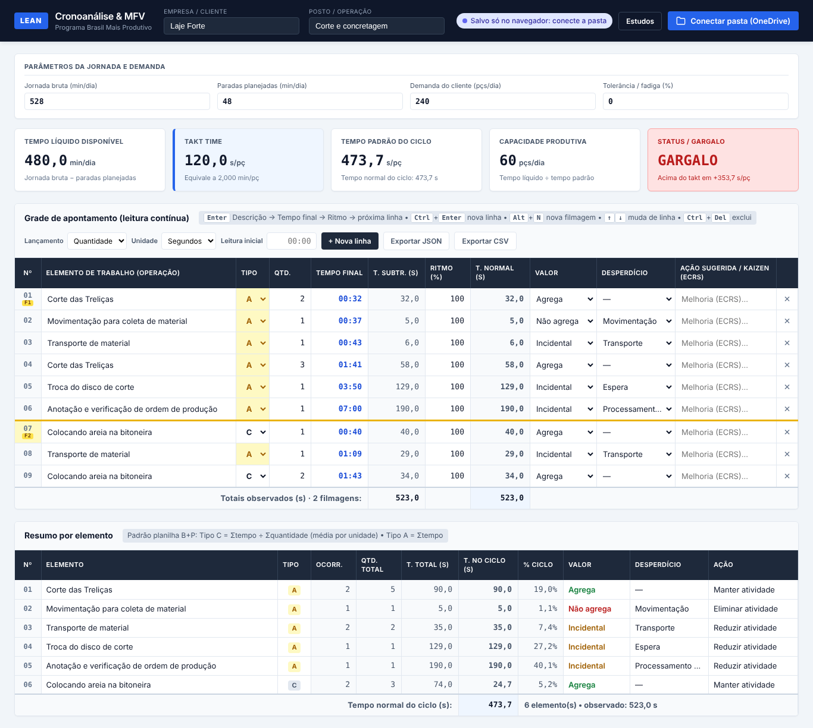
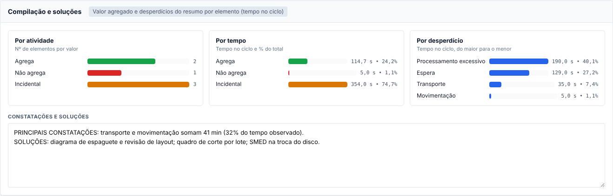
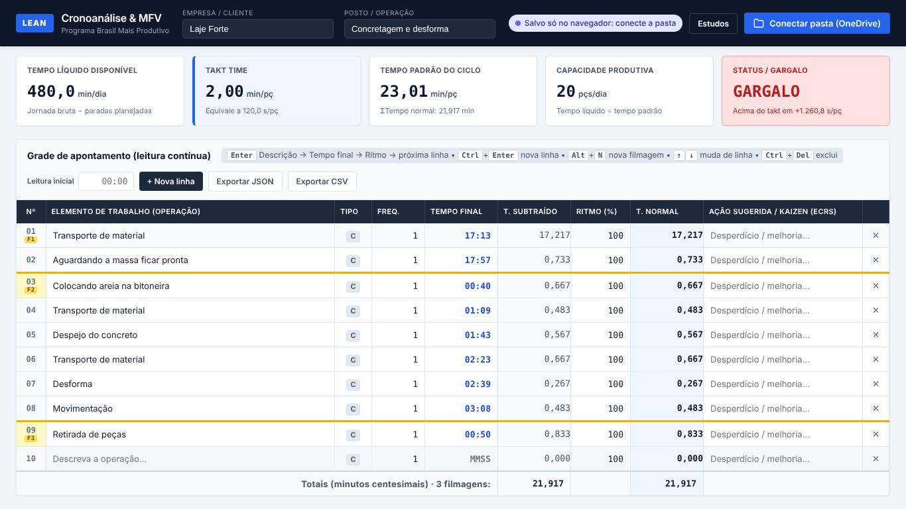
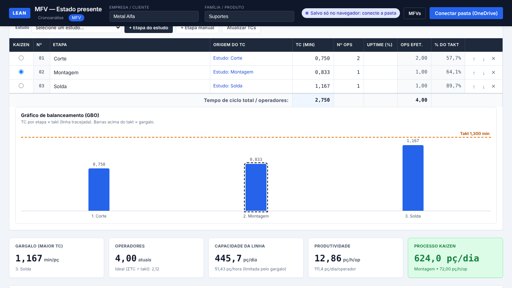

# Lean Chrono & MFV — Cronoanálise e apoio ao Mapa de Fluxo de Valor

> **Versão atual: REV 1.1** (assistente de IA opcional) • versão estável anterior: REV 1.0 — veja o [histórico de revisões](CHANGELOG.md).

Aplicação web **local-first** e **100% sem servidor** para cronoanálise de vídeos de operação, voltada a consultorias de produtividade industrial (Programa **Brasil Mais Produtivo**).

- **Digitação sem mouse:** o consultor assiste ao vídeo e digita só o instante de término de cada elemento (leitura contínua).
- **Cálculo Lean em tempo real:** tempo subtraído, tempo normal, tempo padrão, takt time, capacidade e semáforo de gargalo.
- **Funciona sem internet:** os dados ficam no navegador e na pasta do OneDrive do consultor, em arquivos `.json`.
- **Sem build e sem dependências:** HTML5, CSS3 e JavaScript puro.


---

## 1. Como abrir

| Forma | Como fazer | Recursos disponíveis |
|---|---|---|
| **Direto no navegador** | Dar duplo clique em `index.html` (abre como `file://`) | Cálculo, teclado, salvamento no navegador, exportar/importar JSON e CSV. O botão "Conectar pasta" aparece no Chrome/Edge. |
| **Servidor local** | `python -m http.server 8080` ou `npm start` na pasta do projeto e abrir `http://localhost:8080` | Tudo, inclusive o modo offline (PWA) |
| **GitHub Pages (recomendado para o celular)** | GitHub → *Settings → Pages* → publicar a branch principal (pasta raiz) | Tudo. No celular, use "Adicionar à tela inicial": depois do primeiro acesso, o app abre **sem internet**. |

> Os scripts são carregados como scripts clássicos (sem módulos ES). Por isso o app abre via `file://` sem erro de CORS. O manifesto e o *service worker* só são ativados quando o app é servido por `http/https`.

---

## 2. Fluxo de trabalho

1. Clique em **Estudos → Novo estudo** e informe a **Empresa** e o **Posto/Operação**. Cada posto gera um arquivo.
2. Preencha os **parâmetros da jornada**: jornada bruta (min), paradas planejadas (min), demanda (pçs/dia) e tolerância (%).
3. Se o vídeo não começa em 00:00, informe a **Leitura inicial**.
4. Para cada elemento: **Descrição → `Enter` → Tempo final → `Enter` → Ritmo → `Enter`**. A próxima linha é criada automaticamente.

### Atalhos de teclado

| Tecla | Ação |
|---|---|
| `Enter` | Fluxo rápido: Descrição → Tempo final → Ritmo → próxima linha (cria uma nova se for a última) |
| `Tab` / `Shift+Tab` | Percorre todos os campos, inclusive **Frequência** e **Kaizen** |
| `↑` / `↓` | Mesma coluna, linha anterior/seguinte |
| `Ctrl+Enter` | Nova linha no final da grade |
| `Alt+N` | Marca ou desmarca a linha atual como **início de uma nova filmagem** (também funciona tocando no nº da linha) |
| `Ctrl+Del` | Exclui a linha atual (pede confirmação se houver conteúdo) |
| `Ctrl+S` | Grava imediatamente (sem esperar os 3 s) |

### Digitação do tempo final

| Digitado | Resultado | Minutos centesimais |
|---|---|---|
| `90` | 01:30 | 1,500 |
| `132` | 01:32 | 1,533 |
| `10532` ou `1:05:32` | 1:05:32 | 65,533 |
| `199` | **Recusado**: segundos ≥ 60 (erro de digitação) | — |
| Valor menor que a leitura anterior | **Recusado**: a linha fica em vermelho e o foco permanece no campo | — |

### Padrão da planilha B+P (REV2)

Um estudo novo já abre no padrão da planilha: **lançamento por Quantidade**, tempos em **segundos**, **ritmo 100%** e **tolerância 0%**. Nesse padrão, o resultado é igual ao da planilha. Conferi com as 149 linhas e 9 filmagens da cronoanálise da Laje Forte: deram os mesmos 28 elementos e os mesmos 7.681 s.

| Coluna | Como preencher (teclado) |
|---|---|
| **Tipo** | `C` = cíclico (média por unidade) · `A` = acíclico (soma dos tempos) |
| **Qtd.** | Unidades produzidas no trecho (tempo/un = tempo ÷ qtd). No modo **Frequência**, a mesma coluna recebe `1`, `0,02` ou `1/50` |
| **Valor** | `A` Agrega · `N` Não agrega · `I` Incidental |
| **Desperdício** | Inicial de um dos 8 desperdícios Lean: Superprodução, Espera, Transporte, Processamento excessivo, Estoque, Movimentação, Defeitos, Intelecto |

- **Lançamento** (barra da grade): *Quantidade* (padrão planilha) ou *Frequência* (cronoanálise clássica).
- **Unidade** (barra da grade): *Segundos*, *Minutos* ou *Horas*. Muda a grade, o resumo, o painel e o CSV. A jornada continua em minutos.
- **Mesmo nome = mesmo elemento.** A descrição sugere os nomes já usados e ignora diferenças de maiúsculas e de espaços. Um elemento repetido herda o tipo, o valor e o desperdício da 1ª ocorrência.

### Resumo por elemento (aba "Listagem de Elementos")

Abaixo da grade, o app agrupa as linhas pelo nome do elemento:

| Modo | Tipo C | Tipo A |
|---|---|---|
| **Quantidade** (planilha) | Σtempo ÷ Σquantidade (média por unidade) | Σtempo, ou **Σtempo ÷ Σpeças** com as peças de todas as filmagens |
| **Frequência** | média das ocorrências | média das ocorrências (a frequência já rateia) |

O resumo mostra:
- ocorrências e quantidade total;
- tempo total e tempo no ciclo;
- % do ciclo;
- valor, desperdício e **ação automática**: Agrega → *Manter*, Não agrega → *Eliminar*, Incidental → *Reduzir*.

Classificações divergentes no mesmo elemento aparecem com ⚠. O **tempo normal do ciclo** é a soma do resumo, e é ele que alimenta o tempo padrão, o Takt e o gargalo.



### Compilação e soluções (aba "Compilação e Soluções")

Abaixo do resumo, três gráficos de barras, sempre com rótulo e valor em cada barra:
- **Por atividade:** nº de elementos que Agregam, Não agregam e são Incidentais.
- **Por tempo:** tempo no ciclo e % do total para cada valor.
- **Por desperdício:** os desperdícios classificados, do maior para o menor (Pareto).

O campo **Constatações e soluções** é salvo no estudo e vai para o Excel.



### Vários produtos no mesmo estudo (REV 1.3)

Pela literatura (OIT, Barnes), o tempo padrão é **por produto**. Para analisar vários produtos no mesmo vídeo:

1. Marque **Vários produtos** na barra da grade. Aparece a coluna **Produto**.
2. Digite o produto na 1ª linha de cada trecho. A linha nova repete o produto da anterior.
3. No **Resumo por elemento**, escolha o produto. Resumo, compilação, gráficos e indicadores (ciclo, tempo padrão, capacidade, gargalo) passam a ser **daquele produto**.

| Onde | Como fica com vários produtos |
|---|---|
| Resumo e indicadores | Um produto por vez (seletor no resumo) |
| Peças por filmagem | Uma por produto na filmagem que tem mais de um |
| MFV | O seletor de estudos mostra uma opção por produto ("Posto • Produto"), cada uma com o seu TC |
| Modelo B+P | Sai **só o produto escolhido** (`Crono_<Cliente>_<Posto>_<Produto>_<data>`). Exporte uma vez para cada produto |
| Excel simples e CSV | Coluna Produto, a listagem de todos os produtos e uma tabela de indicadores por produto |

- Desmarcar **Vários produtos** apaga os produtos das linhas (com confirmação).

**Preencher para baixo (REV 1.5):** o produto é confirmado ao sair do campo ou com `Enter` (que segue para a descrição).

| Situação | O que o app faz |
|---|---|
| A linha estava **sem produto** | Copia o produto para as linhas **vazias** logo abaixo, até a próxima linha que já tem produto. Não pede confirmação |
| A linha **já tinha** um produto e você digitou outro | Pergunta se troca também as linhas **seguidas** que tinham o produto antigo. `Enter` = troca o bloco · `Esc` = só esta linha |
| **Filtro ativo** | Só a linha editada muda (o preenchimento mexeria em linhas escondidas) |

- O preenchimento segue a ordem da grade e atravessa a troca de filmagem.
- Exemplo: num estudo de 12 linhas sem produto, digitar "Produto A" na linha 1 e "Produto B" na linha 7 (com `Enter` para trocar o bloco) deixa as linhas 1–6 como A e as 7–12 como B.

#### Carga do posto com vários produtos (REV 1.4)

Num posto que faz vários produtos, o tempo é dividido entre eles. Por isso, o gargalo é avaliado pela **carga do mix** e não pelo takt de cada produto isolado. O quadro **Carga do posto (mix de produtos)** aparece abaixo do resumo:

| Coluna / total | Fórmula |
|---|---|
| Considerar no mix (REV 1.12) | Marcado por padrão. Desmarcado = o produto sai da carga, da ocupação, do takt misto e do TC ponderado (linha em cinza, "fora do mix"). O TP, o resumo e a capacidade dele continuam |
| Demanda (pçs/dia) | Demanda **própria** de cada produto. Desde a REV 1.12, sem ela o produto **não herda** a demanda geral no mix (a demanda geral é a do posto e seria contada uma vez por produto) |
| Carga (min/dia) | TP do produto × demanda |
| % do tempo | Carga ÷ tempo líquido disponível |
| Ocupação do posto | Σ cargas ÷ tempo líquido: 🟢 até 100% (atende o mix) · 🔴 acima de 100% (sobrecarga) |
| Takt misto | Tempo líquido ÷ Σ demandas |
| TC ponderado | Σ (TP × demanda) ÷ Σ demandas |

- Jornada, paradas e tolerância continuam **uma vez por estudo** (são do posto).
- Com vários produtos, o cartão **Status / gargalo** mostra o resultado do mix ("ATENDE O MIX" ou "SOBRECARGA"). O cartão do takt mostra o takt do produto exibido (com a demanda dele) e o takt misto.
- Produto incluído sem demanda própria (ou sem tempo padrão) deixa o mix **incompleto**: carga, ocupação, takt misto e TC ponderado ficam em "--", com o aviso "informe a demanda ou desmarque 'Considerar no mix'".
- Com produto fora do mix, aparece o aviso **"Mix parcial: ocupação do posto subestimada"** e o status ganha "(mix parcial)". Sem nenhum produto no mix: "Informe a demanda ou inclua um produto no mix".
- O **TC ponderado** também pode ir para o MFV como a etapa "Posto • Mix (TC ponderado)".

### Vários operadores no mesmo estudo (REV 1.14)

Quando 2 ou mais pessoas aparecem no **mesmo vídeo** trabalhando no mesmo produto:

1. Em **Nº de operadores**, informe a quantidade e escolha o **Tipo**: POSTO (1 etapa no MFV) ou LINHA (1 etapa por operador).
2. Cada linha recebe a etiqueta **Op1, Op2…** no nº da linha. Troque com **Alt+1…Alt+9** ou clicando na etiqueta (o menu também cria um operador novo e dá nome opcional).
3. Lance as linhas na ordem do vídeo, intercaladas. O tempo subtraído é calculado **pelo mesmo operador** (a 1ª linha de cada um usa o Início da filmagem).
4. Atividade feita em paralelo: a Qtd de cada operador é a produção do posto no trecho.
5. No resumo, o seletor **Operador** mostra cada um ou o posto (Todos). Indicadores do posto: ciclo = maior TP, conteúdo, balanceamento e operadores ideais.

Limitação: os operadores precisam produzir as mesmas peças do trecho filmado. Filmagens separadas de cada operador continuam como estudos separados (Yamazumi/grupo Posto).

### Etapas do processo (REV 1.15)

Para o produto feito em várias etapas (ex.: Enroladinho: Laminação → Queijo → Enrolar):

1. Marque **Etapas** (ao lado de "Vários produtos"): aparece a coluna **Etapa** antes do elemento.
2. Digite a etapa na 1ª linha dela e confirme: o app preenche as linhas vazias abaixo. Na linha em que a etapa muda, digite a nova etapa (o app pergunta se troca o bloco seguinte).
3. O resumo mostra o **TP de cada etapa** ("Etapas (3): 1. Laminação TP 5,0 | …"); o TP do produto é a soma.
4. No **MFV**, o estudo vira uma etapa do fluxo por etapa do processo, já com **Ponderar pela demanda do produto** marcado e o **Operador** preenchido (Op1).

### Filtros da grade e do resumo (REV 1.3)

A barra de filtros fica acima da grade: **nome do elemento**, **produto**, **tipo C/A**, **valor**, **desperdício**, **filmagem** e **só linhas com erro**. Os filtros podem ser combinados.

- **Só escondem linhas da tela.** TS, TN, ciclo e tempo padrão continuam calculados com todas as linhas.
- O resumo também é filtrado, e o aviso mostra o subtotal visível (ex.: filtro *Não agrega* → "Filtro ativo: 12 de 149 linha(s) • resumo: 3 elemento(s), 18,5 s (23,0% do ciclo)").
- **Com filtro ativo, não é possível incluir linhas** (botão, `Enter` na última linha e `Ctrl+Enter`), porque a linha nova entraria fora da sequência do vídeo. Editar descrição, classificação e Kaizen continua liberado. `↑`/`↓` pulam as linhas escondidas.
- O filtro não é gravado: ao abrir um estudo, a grade aparece completa.
- O **Excel simples** sai com o **filtro automático** do Excel nos cabeçalhos da GERAL e da Listagem.

### Exportar Excel

O botão **Exportar Excel** tem dois modos:

| Modo | Quando | Resultado |
|---|---|---|
| **Modelo B+P** | Há um modelo carregado (em *Estudos → Modelo Excel → Carregar modelo*) | A **sua própria planilha** (`.xlsm`/`.xlsx`) preenchida. Fórmulas, gráficos, macros, logotipos, cores e abas ocultas ficam preservados, e o Excel recalcula tudo ao abrir |
| **Excel simples** | Sem modelo, ou pelo botão *Exportar Excel simples* | Layout próprio do app (GERAL, Listagem, Compilação, Análise), só com valores |

**Como funciona o modelo:**
- **Carregar uma vez.** O app reconhece a REV2 pelos cabeçalhos da linha 8 e guarda o modelo no navegador e na pasta **`_Modelos`** do OneDrive. O outro notebook encontra o modelo sozinho ao conectar a pasta.
- **Células preenchidas:**
  - GERAL (linhas 10–300): Elemento, Início, Fim (a 1ª linha da filmagem começa no início da filmagem), Quantidade, Tipo e a lista de elementos;
  - Listagem (linhas 9–134): Elemento, Tempo (s), Qt., Valor e Desperdício, com os textos exatos da planilha;
  - Compilação: constatações em B55;
  - Análise: identificação em C16.
- **Limpeza:** dados e observações deixados no modelo por estudos anteriores são apagados nas áreas preenchidas.
- **Limites vigiados:** 291 lançamentos e 126 elementos. Há um aviso quando passa de 40 elementos, porque a aba Análise da planilha soma só T25:T64.
- **Arquivo gerado:** `Crono_<Cliente>_<Posto>_<data>.xlsm` (com vários produtos: `Crono_<Cliente>_<Posto>_<Produto>_<data>.xlsm`).

O fluxo foi conferido com a planilha real da Laje Forte (149 lançamentos, 9 filmagens). Depois do recálculo, as fórmulas da própria planilha chegaram a **7.681 s** (Análise!G3) e os gráficos de pizza se atualizaram.

#### Planilha REV2.1 da equipe (recomendada)

A REV2.1 é a planilha de cronoanálise da equipe com as fórmulas corrigidas, em branco (sem dados de atendimento), com o mesmo layout, os mesmos gráficos e as mesmas macros da REV2.0. O app reconhece a revisão sozinho ao carregar o modelo.

| Item | Onde | REV2.0 | REV2.1 |
|---|---|---|---|
| Acíclico (tipo A) | GERAL!D7 (peças das filmagens) | Tempo total observado | **Σtempo ÷ peças** quando D7 é preenchida (o app preenche quando há peças em todas as filmagens) |
| Ciclo | Análise!G3 | Soma só 40 elementos | Soma **todos** os elementos |
| Tempo do elemento | GERAL!R | Truncado em segundos inteiros | Segundos com 3 casas |
| Tipo divergente | GERAL!T | — | Alerta "⚠ tipo divergente" |
| Ritmo | GERAL!F | — | **Ritmo (%)** por linha (vazio = 100%); o app leva o ritmo de cada linha |
| Tolerância e TP | Análise!K6:L8 | — | Tolerância (%) e **tempo padrão** = ciclo × (1 + tolerância) |
| Planilha vazia | GERAL!O, Análise!G7/I7 | "QUAL TIPO?" e #DIV/0! | Células vazias |

- Conferida com os 149 lançamentos da Laje Forte, recalculada no LibreOffice: sem peças, G3 = **7.681 s** (igual à REV2.0); com peças, ritmo e tolerância, G3 e TP iguais ao ciclo e ao tempo padrão do app.
- A aba **Controle de Revisão** descreve as mudanças.
- Com a REV2.0, o app avisa que o ritmo não é levado (a planilha não tem a coluna) e que a G3 não usa o acíclico por unidade.

> Dica: use como modelo uma cópia **em branco** da planilha. O app limpa as áreas que preenche, mas abas ocultas como "Listagem de Elementos (2)" e textos fora dessas áreas ficam como estão no modelo.

### Várias filmagens no mesmo estudo

Cada vídeo novo começa em 00:00, como as células amarelas de "Tempo (Início)" na planilha REV2. Para registrar isso no app, há três formas:

1. **Automática:** digite o tempo do novo vídeo normalmente. Como ele é menor que a leitura anterior, o app pergunta *"Esta linha é o início de uma nova filmagem?"*. `Enter` confirma; `Esc` volta para corrigir o tempo.
2. **`Alt+N`** na linha. É necessário quando o 1º tempo do novo vídeo é **maior** que o último do vídeo anterior, porque nesse caso o app não tem como perceber a troca sozinho.
3. **Toque no número da linha**, no celular.

A linha marcada ganha uma faixa amarela e a etiqueta **F2**, **F3**, e assim por diante. O rodapé mostra o total de filmagens.

#### Nome do vídeo de cada filmagem (REV 1.12)

No bloco **Filmagens do estudo**, cada filmagem tem o campo **Vídeo** (nome do arquivo, opcional). Ele aparece na etiqueta F1, F2… ao passar o mouse, no filtro de filmagem, na coluna "Vídeo" do Excel simples e do CSV, e no JSON. Não entra em nenhum cálculo.

#### Início da análise em cada filmagem (REV 1.3)

No bloco **Filmagens do estudo** (acima do resumo), cada filmagem tem o campo **Início**: o instante do vídeo em que a análise começa. Serve para analisar um trecho no meio de qualquer vídeo, sem cortar o arquivo.

| Filmagem | Início |
|---|---|
| F1 | É a **Leitura inicial** da barra da grade (os dois campos ficam sincronizados) |
| F2, F3… | Digite o instante (`530` = 05:30). Vazio = 00:00 |

- A 1ª linha da filmagem = tempo final − início. As demais linhas seguem a leitura contínua.
- Tempo final menor que o início da filmagem deixa a linha em vermelho.
- No modelo B+P, o início vai para a coluna *Tempo (Início)* da 1ª linha da filmagem.



#### Peças produzidas por filmagem (acíclicos por unidade)

Na planilha REV2, o elemento **tipo A** entra no ciclo como **Σtempo**, isto é, o tempo total observado em todas as filmagens. Esse valor não pode ser comparado com o takt, que é por peça.

No modo *Quantidade*, o bloco **Filmagens do estudo** (acima do resumo) tem um campo de peças para cada filmagem (F1, F2…). Com vários produtos, a filmagem que tem mais de um produto ganha um campo de peças por produto:

| Situação | Tipo A no ciclo |
|---|---|
| Nenhuma filmagem com peças | Σtempo (igual à planilha) |
| Peças em parte das filmagens | Σtempo, com aviso ⚠ "faltam peças" |
| Peças em **todas** as filmagens | **Σtempo ÷ Σpeças** (tempo por unidade) |

- Cada filmagem mostra o tempo observado e o **tempo observado ÷ peças**. O bloco mostra também o **ciclo real observado** (tudo o que foi filmado ÷ total de peças, no ritmo filmado), que serve para conferir o tempo normal do ciclo.
- O tempo padrão e o TC levado ao MFV passam a ser por unidade.
- No **modelo B+P**, a aba Listagem recebe o tempo do app (por unidade), mas o ciclo da aba Análise (G3) é calculado pelas fórmulas da planilha a partir da GERAL e continua com o tempo total do tipo A. O app avisa isso ao exportar. O **Excel simples**, o CSV e o JSON levam o tempo por unidade.

- **Frequência:** `1` = uma vez por peça; `1/50` ou `0,02` = uma vez a cada 50 peças. Com frequência menor que 1, o elemento é marcado como **A** (acíclico).
- **Ritmo:** de 50% a 150%. A nova linha herda o ritmo da linha anterior.

---

## 2.1 MFV — Estado presente (`mfv.html`)

O link **MFV** no cabeçalho abre o Mapa de Fluxo de Valor, que reproduz a aba **EP** da planilha "MFV Simplificado". Há **um arquivo por cliente e família** (`MFV_<cliente>_<família>_<data>_<id>.json`), salvo na mesma pasta do OneDrive e com a mesma proteção contra conflito dos estudos.

| Bloco | O que faz |
|---|---|
| **Horário de trabalho** | Entrada, saída, pausas e refeição por dia da semana. Mostra o efetivo por dia e a média por dia trabalhado |
| **Demanda e disponibilidade** | Demanda mensal ÷ dias úteis = demanda diária. Disponibilidade da família (%), unidade do produto (pç, m², kg) e unidade de tempo (s, min, h) |
| **Takt** | Tempo disponível por dia ÷ demanda diária |
| **GBO** | Cada etapa vem de um **estudo de cronoanálise**: o TC é o tempo padrão do estudo. O TC é **editável** (vira "✎ editado", com a opção **↺ usar estudo**). Também é possível criar etapas manuais. Cada etapa tem nº de operadores, uptime (%) e % do takt. **Atualizar TCs** relê os estudos |
| **Gráfico GBO** | Barras por etapa com a linha do takt. Barras acima do takt ficam em vermelho e o processo Kaizen fica tracejado |
| **Resultados** | Gargalo (maior TC), operadores atuais × ideais (ΣTC ÷ takt), capacidade da linha (tempo disponível ÷ maior TC), produtividade (/dia/op e /h/op) e o processo Kaizen marcado |
| **Atravessamento** | Estoques ÷ demanda diária = dias. A soma dá o lead time |
| **Produtividade real (pç/HH)** | Um dia por linha: produção, nº de operadores e horas trabalhadas. Linha de base (T1) × acompanhamento (T3), com o ganho em % contra a meta |
| **Payback** | Investimento ÷ ganho mensal, com as HH economizadas calculadas a partir do pç/HH |

Conferência com o MFV real da Laje Forte (aba EP): deram os mesmos 440 min/dia, a mesma demanda de 206,67 m²/dia, o takt de 0,035484 h, a capacidade de 206,67 m²/dia, a produtividade de 14,09 m²/h/op, 1,00 operador ideal e 8 dias de atravessamento.

> Na planilha, a "Capacidade de Produção Diária da Linha" (K46) usa as horas sem descontar a disponibilidade da família, enquanto o setor Kaizen (N46) desconta. O app usa o **tempo disponível com a disponibilidade** nos dois casos. Com disponibilidade de 100%, os resultados são idênticos.

### Ligação com a cronoanálise (REV 1.4)

| Recurso | Como funciona |
|---|---|
| **Empresa puxada dos estudos** | No **Novo MFV**, o campo Empresa sugere as empresas dos estudos e dos MFVs. Se a grafia for diferente ("metal alfa"), o MFV é gravado com o nome já usado nos estudos ("Metal Alfa") |
| **Família sugerida (REV 1.7)** | O campo Família sugere os **produtos** dos estudos da empresa e as **famílias** dos MFVs que ela já tem. Pelo botão "→ MFV" com um produto selecionado, a Família já vem com o nome dele (editável). A família é decisão do consultor: sem produto, o campo fica em branco |
| **Estudos da empresa** | Ao informar a empresa, aparecem os estudos dela (com produto e Mix, quando houver) e o TC de cada um. Os marcados viram etapas, na ordem da lista, com o TC preenchido. Nº de operadores e uptime ficam para você |
| **Botão "→ MFV"** (na cronoanálise) | Grava o estudo e abre o MFV da mesma empresa. Sem MFV: abre o Novo MFV com a empresa e o estudo já marcados. Com 1 MFV: abre e inclui o estudo como etapa (sem duplicar). Com mais de 1: mostra a lista para você escolher. Com vários produtos, leva o produto exibido no resumo |
| **Aviso de TC atualizado** | Ao abrir o MFV, os TCs das etapas ligadas aos estudos são atualizados e uma faixa mostra o que mudou ("Corte 0,750 → 0,800 min"). **Desfazer** mantém os valores anteriores como TC editado (✎). As etapas editadas à mão nunca são atualizadas |

**Nº total de operadores:** se a mesma equipe faz várias etapas (como na Laje Forte), informe o total da linha em *Demanda e disponibilidade*, como no K37 da planilha. Vazio = soma dos operadores das etapas.

### Conferência dos vínculos (REV 1.11)

Abaixo da tabela de etapas, o MFV lista os avisos (os cálculos não mudam):

- **contagem dupla:** Mix e produto do mesmo estudo, o mesmo posto em duas etapas, ou o estudo de um grupo também como etapa;
- **mix com pesos iguais:** produtos sem demanda própria no estudo;
- **avisos do estudo:** acíclicos sem peças, elementos sem classe, divergências e linhas com erro;
- **demanda da família:** a demanda dos estudos é diferente da demanda diária do MFV.

No **Novo MFV**, as etapas seguem a ordem em que você marca os estudos (1º, 2º, 3º…).

### Produtividade real (pç/HH) e payback — comprovação da meta B+P

A "produtividade" do bloco *Resultados* é **teórica** (capacidade do gargalo ÷ operadores). A meta do programa (+20%) é comprovada com a **produtividade real**, medida no chão de fábrica. Para isso, use o bloco no fim da página:

| Indicador | Fórmula |
|---|---|
| HH do dia | Nº de operadores × horas trabalhadas por operador |
| pç/HH do dia | Produção do dia ÷ HH |
| pç/HH do período | **Σ produção ÷ Σ HH**: média ponderada pelas horas, não a média das médias diárias |
| Ganho | (pç/HH acompanhamento ÷ pç/HH linha de base − 1) × 100 |
| Meta em pç/HH | Linha de base × (1 + meta/100). A meta é editável e vem com 20% |

- **+ Dia (linha de base)** no T1 e **+ Dia (acompanhamento)** no T3. O novo dia repete os operadores e as horas do dia anterior do mesmo período.
- Semáforo: 🟢 meta atingida · 🟡 ganho abaixo da meta · 🔴 queda de produtividade.
- **pç/HH projetado** (opcional): estimativa para o plano de ação, usada só enquanto não houver dias de acompanhamento. Os cartões indicam "projetado" com clareza.
- Linhas incompletas ficam fora das médias e são marcadas em vermelho.

**Payback (REV 1.8: padrão do B+P):**

**Investimento** = **custo do programa B+P** (digitado; varia com o porte e o contrato) + **investimentos do cliente** (se houver). Vale para os dois métodos.

| Método | Ganho mensal | Quando usar |
|---|---|---|
| **Padrão B+P** (padrão nos MFVs novos) | (produção mensal **T3** − **T1**) × **preço de venda** por unidade + outros ganhos | É o cálculo do programa (Módulo T1.4 Indicadores). Exemplo do módulo: +1.000 kg/mês × R$ 3,65 = R$ 3.650/mês; com o custo do programa de R$ 13.920 → **3,8 meses** |
| **Mão de obra** | HH economizadas × custo da HH + outros ganhos. HH economizadas/mês = produção × (1 ÷ pç/HH base − 1 ÷ pç/HH atual) | Quando o ganho é a liberação de horas (sem aumento de produção) |

- **Produção mensal T1** vazia = demanda mensal do MFV.
- **Produção mensal T3** vazia = **estimada** pelo ganho de pç/HH, com as mesmas HH (T1 × (1 + ganho)). O cartão indica "estimada".
- **Atenção:** pelo preço de venda, o ganho é de **faturamento** e só vale se a produção a mais for vendida. Pelo método da mão de obra, só há ganho financeiro se as HH liberadas forem realocadas ou evitadas.
- **Outros ganhos mensais**: só valores comprovados (refugo, retrabalho, estoque, horas extras, área…).
- **Payback (meses) = investimento ÷ ganho mensal**. Até 12 meses fica verde; acima disso, amarelo; sem ganho positivo, "sem retorno".
- MFVs das revisões anteriores com payback preenchido continuam no método da mão de obra.

### Produto estratificado no MFV (REV 1.14)

Quando cada etapa de um produto foi estudada separadamente e a mesma pessoa faz várias etapas:

- **Ponderar pela demanda do produto** (caixa na Origem do TC): TC = TP × demanda do produto ÷ demanda da família. Ex.: Enroladinho 200 de 800/dia → TP 6,72 × 200/800 = 1,68. Desligada por padrão; sem demanda própria no estudo, o TC fica "--".
- **Operador** (coluna da tabela de etapas): digite o mesmo operador (ex.: Op1) nas etapas que ele faz. O app soma a **carga** dele, mostra % do takt e capacidade, conta 1 pessoa e usa a carga como gargalo quando ela for maior que a maior etapa.
- **Não medida** (na etapa manual): a etapa aparece no fluxo e tracejada no gráfico, fora dos cálculos, com aviso de fluxo incompleto.

### Exportar Excel do MFV (modelo B+P)

Em **MFVs → Modelo Excel → Carregar modelo**, escolha a planilha "MFV Simplificado". O botão **Exportar Excel (modelo B+P)** passa a preencher:

| Aba | Células |
|---|---|
| **EP** | Empresa e família (D5:D6), horário (C22:F28), disponibilidade (K28), demanda e dias úteis (O21, O26), unidades (P21:P27, D54, I46:I51), etapas (B39:G51: Kaizen, etapa, TC, nº ops, uptime), total de operadores (K37), estoques (B55:D64) e premissas (B76:B95) |
| **EF** | Mesmos dados gerais do EP, com as etapas e os estoques em branco, para você montar o estado futuro |

**Como os dados são tratados:**
- Os TCs vão em **horas** ("HORAS / peça"). É a única unidade em que todas as fórmulas da planilha (O27, K46, N46, U45) calculam de forma consistente. O takt sai na unidade escolhida no app.
- Contas digitadas pelo consultor em células de entrada (ex.: demanda `=1240/6*26`) são substituídas pelo valor do app. As **fórmulas de cálculo** da planilha são preservadas.
- Onde o modelo não tem a fórmula das horas do dia (ex.: sábado da aba EF), o app grava as horas calculadas.
- O **fluxograma** é uma imagem do modelo e precisa ser atualizado manualmente.

Conferido com o MFV real da Laje Forte: depois do recálculo, 20 de 22 células de resultado ficaram idênticas à planilha original. As duas restantes diferem só pela ordem dos estoques digitados no teste, e o total de 8 dias de atravessamento bateu.



## 2.1.1 Yamazumi — grupos de estudos (`yamazumi.html`, REV 1.9)

Use quando **um produto depende de mais de uma pessoa** (posto com 2 operadores fazendo atividades diferentes) ou para ver a linha inteira empilhada por classe de valor.

1. Em **Grupos**, informe a empresa e o nome, escolha o tipo e a situação (T1 ou T3) e marque os estudos (cada estudo = 1 operador; um estudo com vários operadores (REV 1.14) vira uma barra por operador).
   - **Posto:** vira 1 etapa no MFV.
   - **Linha:** cada estudo vira 1 etapa.
2. O gráfico empilha o TP de cada estudo por **classe de valor** ou **por elemento**, com a linha do takt.
3. Indicadores do grupo:
   - **ciclo** = maior TP;
   - **conteúdo de trabalho** = Σ (TP − espera), em que espera são os elementos com o desperdício "Espera";
   - **balanceamento** = conteúdo ÷ (nº de estudos × ciclo);
   - **operadores ideais** = conteúdo ÷ takt.
4. **Comparar com:** escolha o grupo da outra situação para ver o antes × depois (T1 × T3), com a variação de cada indicador.
5. **→ MFV:** inclui o grupo no MFV da empresa. No posto, o TC é o ciclo, e os operadores ideais do MFV usam o conteúdo de trabalho. O takt do grupo vale só no Yamazumi.

## 2.2 Assistente de IA (Gemini), opcional

O botão **✨ IA** na barra da grade abre o assistente. Ele precisa de **internet** e de uma **chave de API do Google AI Studio** (aistudio.google.com → ícone 🔑 → *Create API key*).

1. Na primeira vez: cole a chave → **Carregar modelos** → escolha o modelo (o app sugere um "flash") → **Salvar configuração**.
2. Use os botões:
   - **Classificar valor e desperdício:** para os elementos ainda sem classificação;
   - **Sugerir ações Kaizen (ECRS):** para os elementos que não agregam ou são incidentais;
   - **Redigir constatações e soluções:** um rascunho editável para a Compilação;
   - **Padronizar nomes dos elementos:** junta variações do mesmo elemento ("anotar a OP" → "Anotar OP");
   - **Pergunte sobre este estudo:** perguntas livres, respondidas só com os dados do estudo.
   No **MFV**, o botão **✨ Resumo executivo (IA)** gera um texto para a diretoria do cliente, usando a mesma configuração.
3. Revise as sugestões, desmarque o que não concordar e clique em **Aplicar**. Só os campos vazios são preenchidos.

**Privacidade:**
- A chave fica **só neste navegador**.
- Com **Anonimizar** (ligado por padrão), o nome do cliente e do posto não são enviados.
- No nível gratuito do Gemini, o Google pode usar os dados enviados para melhorar os produtos; confira os termos da sua chave no AI Studio.
- Os cálculos nunca usam IA.

## 3. Regras de cálculo

| Indicador | Fórmula |
|---|---|
| Tempo subtraído (TS) | Tempo final da linha − última leitura válida (a 1ª linha de cada filmagem usa o **início da filmagem**: Leitura inicial na F1, campo Início nas demais, vazio = 00:00) |
| Tempo normal da linha (TN) | TS × (Ritmo / 100) [× Frequência, no modo frequência] |
| Tempo do elemento (resumo) | Quantidade: C = ΣTN ÷ ΣQtd · A = ΣTN (ou ΣTN ÷ Σpeças das filmagens) — Frequência: média das ocorrências |
| Tempo normal do ciclo | Σ tempos dos elementos do resumo |
| Tempo padrão (TP) | Tempo normal do ciclo × (1 + Tolerância / 100), método multiplicativo da OIT |
| Tempo líquido disponível (TLD) | Jornada bruta − Paradas planejadas |
| Takt time | TLD ÷ Demanda diária |
| Capacidade | ⌊TLD ÷ TP⌋ peças/dia |
| Gargalo | TP > Takt → 🔴 **GARGALO** · TP ≤ Takt → 🟢 **BALANCEADO** |

- Todos os tempos estão em **minutos centesimais**. Os cálculos usam precisão total; o arredondamento é só na exibição.
- Linhas com erro ficam **fora dos totais** e o painel informa quantas são.
- Com demanda zero ou paradas maiores que a jornada, o painel mostra **"Verificar"**, não "gargalo".
- Arquivos `.json` de versões anteriores abrem no modo *Frequência* em *minutos*, preservando os resultados de antes.

---

## 3.1 Arquivar (REV 1.16)

Em **Estudos**, **MFVs** e **Grupos**, o botão **Arquivar** tira o item da lista sem apagar:
- **Com a pasta conectada:** o arquivo vai para a subpasta `_Arquivo`. Para trazer de volta, mova o arquivo para a pasta.
- **Sem pasta:** o app baixa o `.json` e tira o item do navegador. Para trazer de volta, use "Importar JSON".

O documento aberto não pode ser arquivado.

## 4. Armazenamento e sincronização

### Notebook (Chrome/Edge): pasta do OneDrive

1. Clique em **Conectar pasta (OneDrive)** e escolha a pasta sincronizada.
2. Cada alteração é salva **na hora no navegador** e **na pasta 3 s depois da última tecla** (*debounce*), para não sobrecarregar a sincronização do OneDrive.
3. Ao reabrir o navegador, ele pede a permissão de novo: clique em **Reautorizar pasta**. Enquanto isso, nada se perde, porque tudo continua salvo no navegador.
4. O botão **Estudos** lista os arquivos `Crono_*.json` da pasta e os estudos guardados no navegador.

**Nome do arquivo:** gerado uma única vez na criação, sem acentos e com um ID único. Exemplo: `Crono_Industria_Metalurgica_Alfa_Montagem_Final_Posto_01_2026-10-15_a1b2c3d4.json`. Renomear o cliente ou o posto **não** cria um arquivo novo.

**Proteção contra conflito (dois notebooks):** cada arquivo tem um número de **revisão**. Antes de gravar, o app confere se a pasta ainda está na revisão que ele conhece. Se outro dispositivo gravou antes:

- o arquivo da pasta **não é sobrescrito**;
- a versão desta tela é salva como cópia `..._conflito_AAAAMMDD-HHMMSS.json`;
- um aviso vermelho oferece **Usar versão da pasta** ou **Manter minha versão (sobrescrever)**.

> A proteção depende de o OneDrive já ter sincronizado a versão do outro dispositivo. Se os dois gravarem ao mesmo tempo, sem sincronizar, o próprio OneDrive cria uma cópia com o nome do computador.

### Celular / tablet (ou Firefox/Safari): modo navegador

Esses navegadores não permitem acesso a pastas. O app detecta isso sozinho e:

- salva continuamente no **IndexedDB** do navegador e pede armazenamento persistente para evitar limpeza automática;
- mostra no indicador quando foi o último export, por exemplo "Salvo no navegador • exportado há 2 h";
- oferece **Exportar JSON** (envie o arquivo para a pasta do OneDrive) e **Importar JSON** (em *Estudos*).

Ao importar no notebook um estudo editado no celular, a revisão do arquivo serve de base para detectar conflito com a pasta.

---

## 5. Formato do arquivo `.json`

```json
{
  "schema": "lean-chrono-estudo",
  "schemaVersion": 1,
  "id": "a1b2c3d4-…",
  "fileName": "Crono_Industria_Alfa_Posto_01_2026-10-15_a1b2c3d4.json",
  "revision": 3,
  "createdAt": "2026-10-15T10:00:00.000Z",
  "updatedAt": "2026-10-15T10:42:00.000Z",
  "clientName": "Indústria Alfa",
  "processName": "Posto 01",
  "videoStart": "00:00",
  "settings": { "entryMode": "quantidade", "timeUnit": "s" },
  "shiftParams": { "shiftTimeMin": 528, "plannedStopsMin": 48, "dailyDemandPcs": 240, "tolerancePct": 5 },
  "elements": [
    { "id": "…", "description": "Soldar", "type": "C", "quantity": "2", "frequency": "1", "videoTime": "01:12",
      "pace": "100", "value": "AG", "waste": "", "kaizen": "", "newVideo": false }
  ],
  "results": { "unit": "minutos centesimais", "taktTimeMin": 2, "standardTimeMin": 1.386, "capacityPcsDay": 346, "status": "balanceado", "…": "…" }
}
```

O bloco `results` é um **resumo para leitura externa** (Excel, Power BI). Ele é recalculado a cada gravação e ignorado ao abrir o arquivo.

---

## 6. Estrutura do projeto

```
index.html            Estrutura da tela
style.css             Estilos (desktop, tablet, celular e impressão)
js/calc.js            Motor de cálculo e modelo de dados (funções puras, testadas)
js/xlsx.js            Excel simples (gerador .xlsx próprio, sem dependências)
js/xlsx-template.js   Preenchimento do modelo B+P do consultor (preserva fórmulas, gráficos e macros)
js/storage.js         IndexedDB, pasta do OneDrive, exportar/importar
js/ui.js              Renderização e navegação por teclado
js/app.js             Orquestração: estado, autosave, conflitos, gerenciador de estudos
js/ai.js              Assistente de IA (Gemini): pedidos, anonimização e validação das respostas
js/ai-ui.js           Tela do assistente de IA (configuração, sugestões e aplicação)
mfv.html              Página do MFV (estado presente)
js/mfv-calc.js        Motor de cálculo do MFV (aba EP: horário, takt, GBO, capacidade, atravessamento)
js/mfv-app.js         Tela e salvamento do MFV (mesma pasta e proteção contra conflito)
yamazumi.html         Página do Yamazumi (grupos de estudos)
js/yamazumi-calc.js   Motor do Yamazumi: classes de valor, ciclo, conteúdo, balanceamento, T1 × T3
js/yamazumi-app.js    Tela e salvamento dos grupos
sw.js                 Service worker (offline)
manifest.webmanifest  Instalação como app (PWA)
tests/                Testes automatizados
```

Ao alterar qualquer arquivo do app, incremente `CACHE_VERSION` em `sw.js` para os celulares receberem a atualização.

---

## 7. Testes

```bash
npm test             # 154 testes: cálculo, filmagens, produtos, Excel, modelos B+P, MFV, pç/HH, payback, IA e Yamazumi (Node 18+, sem dependências)
npm run test:e2e     # navegador (Playwright): cronoanálise, MFV, IA simulada, REV 1.2 a 1.5 e Yamazumi (REV 1.9) — requer o servidor local
```

O teste de ponta a ponta no navegador (`tests/e2e.browser.js`) usa Playwright e cobre:

- fluxo de teclado completo;
- indicadores;
- erros de digitação;
- persistência;
- exportação;
- gravação na pasta com debounce;
- conflito entre dispositivos;
- modo celular.

As instruções estão no cabeçalho do arquivo.

---

## 8. Limitações conhecidas (MVP)

- O cálculo estatístico do número de ciclos necessários e o MFV **estado futuro** (aba EF) ficam para as próximas etapas.
- O MFV não gera o desenho do fluxograma (ele continua como imagem no modelo).
- No celular a grade usa rolagem horizontal; o modo "cartão" fica para a fase 2.
- Estudos alterados no navegador sem pasta conectada só são gravados na pasta quando forem abertos novamente com a pasta conectada (o gerenciador marca "Alterações não gravadas na pasta").
- A gravação na pasta usa a File System Access API, disponível no Chrome e no Edge para computador.
